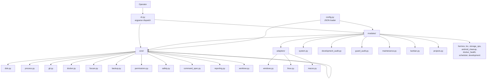
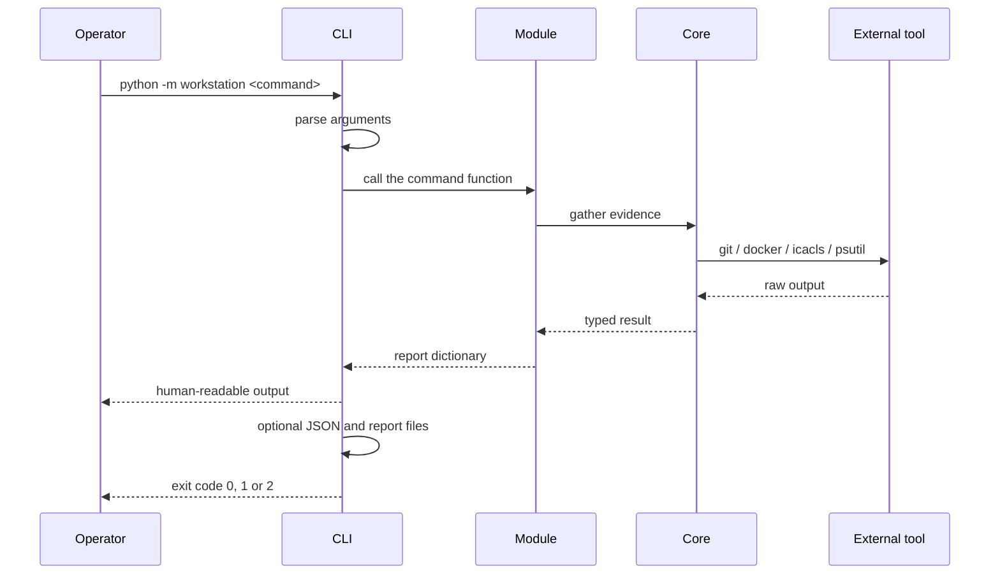

# Architecture

How the Workstation Toolkit is put together, and why. For the commands
themselves see the [command reference](command-reference.md); for
configuration see the [configuration reference](configuration.md).

## Overview

The toolkit is a command-line program that inspects and maintains a developer
workstation. It audits the machine, the repositories under it, the Git
worktrees beside them, Docker, the project toolchains, and the state of the
Hermes agent. It can also back up and restore the local configuration and
that agent's state database.

The design has one organising idea: **the toolkit is read-only unless a
command says otherwise, and every mutation is gated behind an explicit
intent.** A command that changes something previews the change first, names
the action, and requires an execution flag before it touches anything.

## Context

The toolkit runs on the machine it audits, with the privileges of the person
running it. It has no server, no daemon and no database of its own.

It deliberately does **not**:

- install, update or remove software;
- terminate a process unless it is handed one explicit process identifier;
- act on a resource it was not told about through configuration;
- run a configured shell command without a separate, explicit opt-in;
- guess. Where the platform offers no reliable evidence, the toolkit reports
`unknown` rather than a plausible answer.

## Technology stack

| Component | Choice | Rationale |
|---|---|---|
| Runtime | Python 3.10 or later | The standard library covers process, disk, SQLite and JSON work without a native dependency |
| CI targets | Python 3.11 and 3.12 | The two versions the project is tested against |
| Runtime dependencies | `psutil` only | Cross-platform process and memory inspection; everything else is the standard library |
| Git | The real `git` command line | The toolkit reads Git's own view of the repository rather than reimplementing it |
| Docker | The real `docker` command line | Same reason: Docker's own output is the source of truth |
| Permissions | `icacls` on Windows, POSIX modes elsewhere | The platform's own mechanism, so the result can be verified |
| Reports | JSON and Markdown under `reports/` | Machine-readable and human-readable from the same payload |
| Documentation | MkDocs Material, Mermaid diagrams | The site is built from the same Markdown that GitHub renders |

The toolkit has no web framework, no ORM, no plugin system and no background
scheduler of its own. It shells out to the tools that already own the
domain.

## Module map



Dependencies point downwards only. `core/` never imports `modules/`, and
`adapters/` never imports `core/`. The CLI is the only place that knows
which module implements which command.

## Layers

### Entry point

| File | Responsibility |
|---|---|
| `cli.py` | Builds the `argparse` parser, dispatches to a module, prints the human-readable output, and sets the exit code |
| `__main__.py` | Makes `python -m workstation` work |

The CLI owns three things and nothing else: argument parsing, the order in
which output is printed, and the exit code. Every decision about *what* to
do lives in a module.

### Configuration

| File | Responsibility |
|---|---|
| `config.py` | Loads the JSON configuration files and resolves the environment variables |

The loader reads JSON only. The `*.toml.example` files in `config/` are
commented reference material: they are never parsed, merged or read by any
command, and a test asserts that the loader source contains no TOML handling.

### Core operations

Portable operations, each in one module, with no knowledge of the commands
that use them.

| File | Responsibility |
|---|---|
| `core/disk.py` | Mounted-drive capacity and bounded large-item inspection |
| `core/process.py` | Process listing, orphan detection and termination, through `psutil` |
| `core/git.py` | Git identity classification, repository state and remote inspection |
| `core/docker.py` | Docker image, container and volume state, and the explicit prune operations |
| `core/fsscan.py` | The shared filesystem walker used by every size measurement |
| `core/backup.py` | Timestamped backups and read-only manifest verification |
| `core/permissions.py` | Owner-only permissions for backup artefacts, per platform |
| `core/safety.py` | The shared execution and free-space gates |
| `core/command_spec.py` | Parsing and validation of configured commands into an explicit mode |
| `core/reporting.py` | Timestamped JSON and Markdown report writing |
| `core/worktree.py` | Worktree audit, lock probing, quarantine and deletion |

### Composed commands

Each module here implements one command or one family of commands, and
combines core operations into a report.

| File | Responsibility |
|---|---|
| `modules/system.py` | Platform adapter selection; the `diagnose` and `storage` reports |
| `modules/development_audit.py` | Repository hygiene, toolchain, Java and Android SDK audits |
| `modules/guard_audit.py` | Process risk evidence and single-PID termination |
| `modules/maintenance.py` | Backup, restore planning, restore execution and Hermes database maintenance |
| `modules/kanban.py` | Kanban board health, archive planning and selective archiving |
| `modules/projects.py` | Project status and the execution of configured project commands |
| `modules/hermes.py` | Hermes profile, state database and skill health |
| `modules/loc.py` | Source line-count auditing |
| `modules/storage_ops.py` | Disk pressure forecasting |
| `modules/android_cleanup.py` | Android SDK cleanup planning from declared Gradle requirements |
| `modules/docker_health.py` | Container health and bounded log inspection |
| `modules/scheduler.py` | Health-report schedule planning and creation |
| `modules/development.py` | Development-environment entry points shared by the other audits |

### Platform adapters

| File | Responsibility |
|---|---|
| `adapters/base.py` | The `PlatformAdapter` interface: firewall, startup items, system logs, package manager |
| `adapters/windows.py` | PowerShell-based firewall, startup and event-log inspection |
| `adapters/linux.py` | UFW and firewalld detection, systemd user units, `journalctl` |
| `adapters/macos.py` | Application firewall query, launchd inventory, `log show` |

An adapter that cannot answer returns an explicit status. It never returns a
plausible value for a platform it does not support.

## Execution flow



The exit code is derived from the report, not from whether the command
raised. A command that completes and reports a failure exits `1`; a command
that completes and reports success exits `0`; an argument the parser rejects
exits `2`. An error that prevents the command from running at all is printed
as a single line on standard error, never as a traceback.

## Safety model

The safety rules are not documentation. They are the gates in the code, and
each one has a test.

### The execution gate

`core/safety.py` holds the shared gate:

```python
def require_execute(execute: bool, yes: bool, action: str) -> None:
    if not execute:
        raise SafetyError(f"{action} is a dry-run by default; pass --execute.")
    if not yes:
        raise SafetyError(f"{action} requires --yes after reviewing the dry-run.")
```

Two flags are required, not one. `--execute` states the intent, and `--yes`
states that the preview was reviewed. A command that mutates anything calls
this gate, or an equivalent check of its own.

### The free-space gate

`require_free_space` refuses an operation that needs room when the volume
has less than the requested headroom. The Hermes database maintenance uses
it with a 15 GB default.

### The classified-resource rule

A resource is only acted on when it has been *positively classified* as
disposable. The worktree deletion is the clearest example:

1. The path must be an immediate child of the repository's `.worktrees`
   directory, and must not be a symbolic link.
2. The path must not be registered in `git worktree list`.
3. The path must not carry a confirmed operating-system lock.
4. The directory is moved atomically to an unpredictable sibling name, and
   the directory entry identity is compared before and after the move.
5. Git registration is queried again, after the move.
6. The recursive removal is confined to the quarantined entry.

A path swap between the check and the deletion therefore cannot redirect the
deletion somewhere else, and a worktree registered a moment before the move
is not deleted.

### The read-only probe

A directory lock cannot be detected by touching the directory, so the audit
does not try. On Windows the probe opens the directory with `DELETE` access
and `FILE_FLAG_BACKUP_SEMANTICS`; the request fails with
`ERROR_SHARING_VIOLATION` when another handle holds the directory without
`FILE_SHARE_DELETE`. The handle is closed immediately and nothing is
created, renamed or removed.

On POSIX there is no kernel-enforced directory lock, because an open file can
always be unlinked. The toolkit reports `unknown` there, which is the honest
answer, and it never asserts a lock it cannot evidence.

### The explicit-mode rule

Configured project commands are executable code. `core/command_spec.py` turns
a configured value into one of two explicit modes:

| Mode | How it runs | Gate |
|---|---|---|
| `argv` | Without a shell. Every element is passed literally to the operating system, so a value such as `release && rm -rf build` is data, never syntax | None beyond `--execute` |
| `shell` | Through the platform shell | `--allow-shell`, or `WORKSTATION_ALLOW_SHELL=1` for unattended runs |

The opt-in for shell mode deliberately lives outside the configuration file,
so that somebody able to edit the configuration cannot grant themselves the
right to run arbitrary shell code. A legacy plain-string command is
classified automatically: a string without shell syntax is split into an
argument list and runs without a shell, and a string with shell syntax
requires the opt-in and reports a migration hint.

### The fail-closed rule

When the toolkit cannot establish that an operation is safe, it refuses. It
does not fall back to a weaker implementation:

- **Restore** binds destination writes to a directory descriptor opened from
  an authorised root, so a swapped parent cannot redirect them. The
  capability is detected at import time by inspecting `os.supports_dir_fd`
  and the signature of `os.replace`. Where the capability is missing -
  Windows, for example - `restore --execute` refuses. `--plan` stays
  available everywhere.
- **Backup permissions** distinguish four outcomes. `enforced` means the
  platform applied the owner-only policy. `preserved` means it was already
  stricter and was left alone. `unsupported` means the filesystem positively
  reports it cannot express the policy. `failed` means the outcome could not
  be established at all. Only `failed` and `unsupported` abort a backup, and
  an incomplete payload is removed rather than left behind.

### The identity rule

`git-identity --fix` unsets local identities that are known to be unsafe for
shared repositories. It never writes an identity, so it cannot silently
change who a commit is attributed to.

## Key design decisions

| Decision | Reason | Consequence |
|---|---|---|
| Shell out to `git` and `docker` rather than reimplement them | Their output is the source of truth; a reimplementation would drift | The tools must be installed and on the path |
| One runtime dependency (`psutil`) | Fewer places for a platform difference to hide | Process memory limits are `psutil`'s |
| A shared filesystem walker (`core/fsscan.py`) | Every size measurement walked the tree its own way, which is where the slow paths came from | Exclusions and link handling are defined once |
| JSON configuration only | One parser, one error surface | TOML examples are reference material and are never read |
| Two flags for every mutation (`--execute` and `--yes`) | The preview and the approval are separate acts | Slightly longer command lines |
| The shell opt-in lives in the environment, not the config | Editing the configuration must not grant shell rights | Shell mode needs `--allow-shell` or `WORKSTATION_ALLOW_SHELL=1` |
| Report `unknown` rather than guess | A wrong lock state would authorise a deletion | POSIX lock state is always `unknown` |
| Fail closed on restore | A silent fallback could write outside the authorised root | `restore --execute` is POSIX-only |
| The CLI owns the exit code | Modules report outcomes; the CLI translates them | A new command must set its own exit behaviour |

## Extension points

| To add | Do this |
|---|---|
| A command | Add a `cmd_*` function and an `add_parser` entry in `cli.py`, then implement it in `modules/` |
| A platform capability | Extend `PlatformAdapter` in `adapters/base.py` and implement it in all three adapters |
| A configuration key | Load it in `config.py`, document it in the configuration reference, and add it to the tests that bind documentation to the loader |
| A measurement | Use `core/fsscan.py` rather than a new tree walk, so exclusions and link handling stay consistent |

## Verification

The claims in this document are checked, not asserted:

| Claim | Checked by |
|---|---|
| Every command is documented | `tests/test_documentation.py` compares the parser's subcommands with the command reference |
| Every documented command exists | `tests/test_documentation.py` compares the documentation with the parser |
| The configuration loader reads only JSON | `tests/test_documentation.py` |
| Every documented environment variable is read by the source | `tests/test_documentation.py` |
| The exit codes behave as documented | `tests/test_documentation.py` runs the CLI |
| The safety gates hold | The dedicated tests for backup, restore, worktrees, projects and maintenance |
| The documentation uses one language and one spelling | `tests/test_documentation.py` |

The source tree at the time of writing:

| Tree | Files | Lines |
|---|---|---|
| `src/workstation/` | 34 | 4679 |
| `src/workstation/core/` | 11 | 2527 |
| `src/workstation/modules/` | 14 | 1536 |
| `src/workstation/adapters/` | 5 | 161 |
| `tests/` | 29 | 4382 |

## Related

- [Documentation index](index.md)
- [Command reference](command-reference.md)
- [Configuration reference](configuration.md)
- [Backup permissions](backup-permissions.md)
- [Changelog](../CHANGELOG.md)
- [Contributing](../CONTRIBUTING.md)
