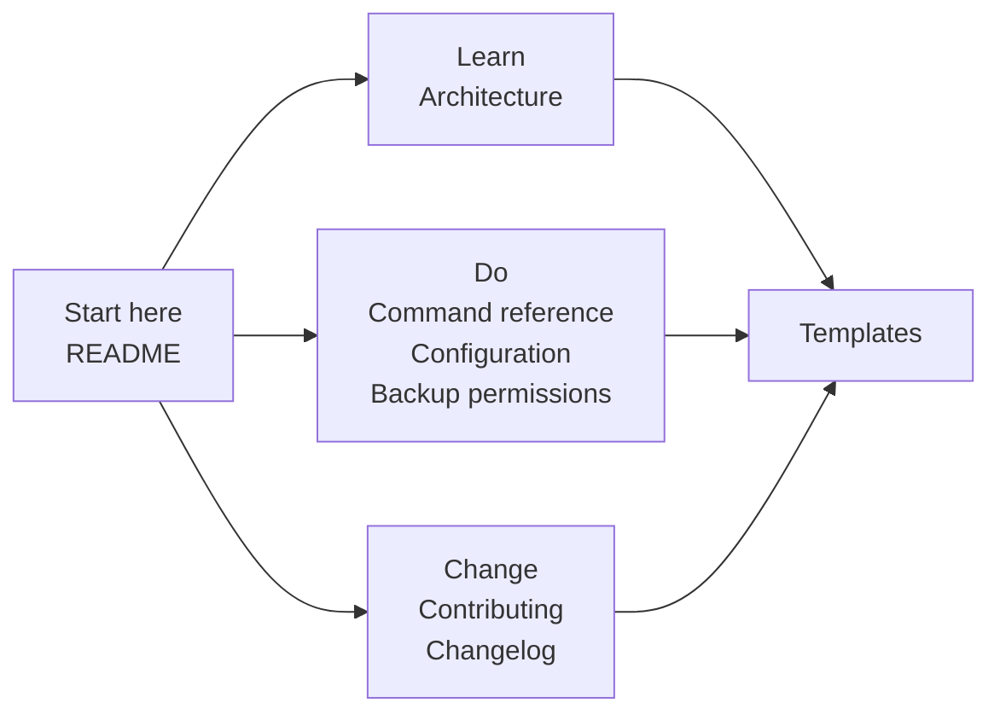

# Documentation

The documentation for the Workstation Toolkit, a cross-platform workstation
operations toolkit for Windows, Linux and macOS.

Start with the [README](../README.md) for the quick start and the command
table. Everything else is here.

## Where to look

| I want to | Read |
|---|---|
| Install it and run my first command | [README](../README.md#install) |
| Know what a command does and what its flags are | [Command reference](command-reference.md) |
| Know how the code is put together | [Architecture](architecture.md) |
| Configure repositories, projects and paths | [Configuration reference](configuration.md) |
| Understand who can read a backup | [Backup permissions](backup-permissions.md) |
| See what changed and when | [Changelog](../CHANGELOG.md) |
| Contribute a change | [Contributing](../CONTRIBUTING.md) |
| Start a new document from the house style | [Template library](templates/index.md) |

## How the documentation is organised

The documents are separated by what the reader is doing, not by when they
were written.

- **Explanation** - [architecture.md](architecture.md) explains how the
  toolkit is built and why the safety rules are shaped the way they are.
- **Reference** - [command-reference.md](command-reference.md),
  [configuration.md](configuration.md) and
  [backup-permissions.md](backup-permissions.md) are looked up rather than
  read through. Every flag, default and outcome is stated.
- **Process** - [CONTRIBUTING.md](../CONTRIBUTING.md) states the branch, test
  and documentation rules, and [CHANGELOG.md](../CHANGELOG.md) records what
  changed.

## The rules the documentation follows

1. **The source is authoritative.** When a document and the code disagree, the
   code is right and the document is wrong.
2. **Every claim is verified** against the source or against the command's own
   `--help` output before it is written down, and the check is repeatable.
3. **The tests enforce it.** `tests/test_documentation.py` compares the
   documentation with the parser, the configuration loader and the
   environment variables the source actually reads, so the documentation
   fails the build when it drifts.
4. **One language, one spelling.** British English throughout, enforced by a
   test.
5. **Every document is reachable** from exactly one index.

## Related

- [Architecture](architecture.md)
- [Command reference](command-reference.md)
- [Configuration reference](configuration.md)
- [Backup permissions](backup-permissions.md)
- [Template library](templates/index.md)
- [Changelog](../CHANGELOG.md)
- [Contributing](../CONTRIBUTING.md)
