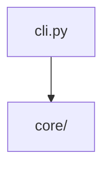
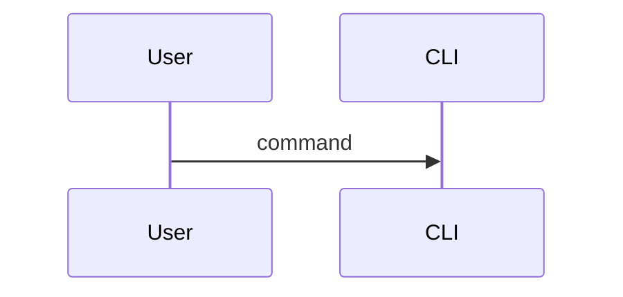

# Architecture template

Copy this file to `docs/architecture.md` and replace the placeholders. The
live architecture document for this project is at
[architecture.md](../architecture.md).

## Structure

A complete architecture document has these sections, in this order.

1. **Overview** - what the system is, in two or three sentences, and who it
   is for.
2. **Context** - the problem the system solves and the boundary it draws
   around itself. State what the system deliberately does not do.
3. **Technology stack** - the language, runtime, dependencies and the external
   tools the system shells out to.
4. **Module map** - a diagram of the packages and the direction of the
   dependencies between them.
5. **Layers** - one subsection per layer, with a table of the files in it.
6. **Request or execution flow** - the path a command takes from the command
   line to the output, as a sequence diagram.
7. **Safety model** - the rules that decide whether an operation may change
   anything.
8. **Key design decisions** - a table of decision, reason and consequence.
9. **Extension points** - where a new capability is meant to be added.
10. **Verification** - how the document's claims are checked, and by what.

## Rules

1. **Every file named in the document exists.** A path that has been deleted
   is worse than no path, because a reader trusts it.
2. **Every number is measured.** Line counts, file counts and sizes come from
   the tree at the time of writing, not from memory.
3. **Diagrams are Mermaid.** Use `flowchart`, `sequenceDiagram`,
   `stateDiagram-v2` or `erDiagram`. Quote a node label that contains a
   space: `A["Label"] --> B["Label"]`.
4. **Dependency direction is stated.** A diagram that shows boxes without
   showing which way the calls go is a picture, not an architecture.
5. **Explain the why.** The structure is obvious from the tree; the reason for
   the structure is not.
6. **State the limits.** A document that only describes the happy path is
   incomplete.

## Skeleton

```markdown
# Architecture

## Overview

## Context

## Technology stack

| Component | Choice | Rationale |
|---|---|---|
| Runtime | Python 3.11+ | |

## Module map



## Layers

### Layer name

| File | Responsibility |
|---|---|

## Execution flow



## Safety model

## Key design decisions

| Decision | Reason | Consequence |
|---|---|---|

## Extension points

## Verification

## Related

- [Documentation index](../index.md)
- [Changelog template](changelog_template.md)
- [Template library index](index.md)
```

## Related

- [Documentation index](../index.md)
- [Changelog template](changelog_template.md)
- [Template library index](index.md)
